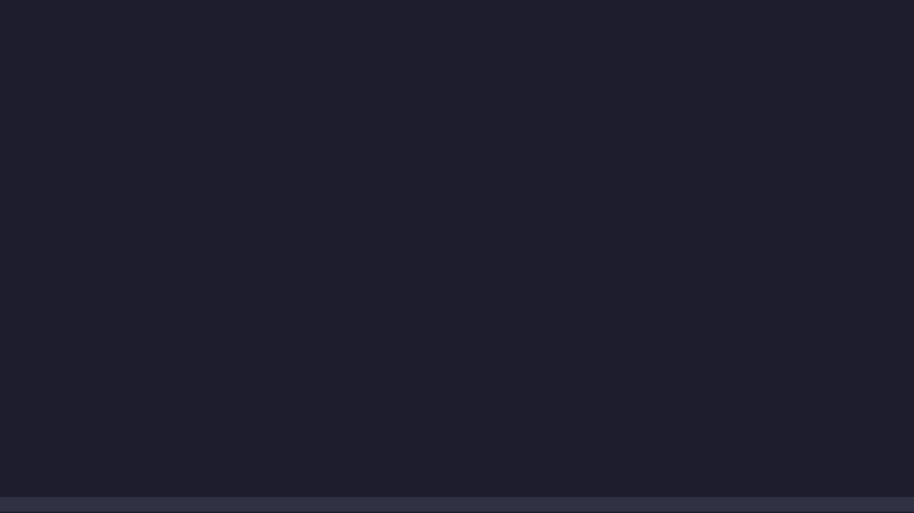

# pspsps

[](LICENSE)


A pixel cat that lives on your macOS screen while you work.



## Features

- **Needs.** Energy, boredom and wish for attention change over time. The cat picks what to do from what it needs most.
- **Activities.** Walks, rests, washes, sleeps at favourite spots, has evening zoomies.
- **Cursor play.** Chases a fast pointer; stalks a still one, wiggles and pounces.
- **You.** Falls asleep when you are away, greets you when you are back, sits on your active window.
- **Mouse.** Click it and it meows; drag it anywhere. Clicks pass through everywhere else.
- **Terminal.app.** Inside a Terminal window, empty space is the floor and every line of text is a shelf. The cat walks around the text, jumps onto lines and climbs them. It rides along when you scroll or new output pushes the text up.
- **Generated frames.** Stalk, creep and pounce frames are built in code from the sheet's pixels and palette.
- **Transitions.** Sitting, lying down, crouching into a stalk and rolling over in sleep play in-between frames made from the two poses (the rear sits first, the front lies down first). Turns stay quick cuts. No blending, no new colors.

## Requirements

- macOS (tested on 15), Python 3.14
- Accessibility permission for the terminal you start it from (for the Terminal.app features)

## Run

```sh
python3 -m venv .venv
.venv/bin/pip install -r requirements.txt
.venv/bin/python pet.py
```

The 🐱 menu-bar item shows what the cat is doing and how it feels, and lets you ask for an activity,
pick a cat and an accessory, toggle sound, quit.

| command | |
|---|---|
| `pet.py` | run the cat |
| `pet.py test` | tests |
| `pet.py sim 8` | simulate an 8-hour working day, print where the time went |
| `pet.py check` | validate `brain/anim.json`, list pose junctions |
| `pet.py gen` | write generated frames and a before/after sheet to `assets/generated/` |
| `pet.py tween` | rebuild the in-betweens (`brain/transitions.json`), preview in `assets/generated/transitions.png` |
| `pet.py film` | play the promo in the terminal; `vhs film.tape` records it |

## Layout

```
pet.py            entry point
brain/
  anim.json       frames, poses, clips, generated-frame recipes, habits, needs
  config.py       loads anim.json, mirrors left-facing poses and clips
  sprites.py      sheets, layers, generated frames
  transitions.json  in-between frames for every pose link (made by tween.py)
  tween.py        builds the in-betweens
  body.py         pose graph, walking, jumping, shelves
  mind.py         needs, choosing and running activities
  world.py        a Terminal window as a world: floor, text, shelves, paths
  terminal.py     Terminal.app text and positions via the Accessibility API
  senses.py       pointer speed and stillness
  memory.py       favourite sleep spots
  app.py          macOS window, menu, mouse, scrolling
  sim.py          headless simulator
  film.py         the promo, drawn with half-block characters
  check.py        config validation
  tests.py        tests
assets/
  sprites/        32x32 sheets, 352x1696 px: base/ cats, valentine/ and winter/ accessories
  aseprite/       editable sources of the sheets
  reference/      animation list, frame indexes, palette
  generated/      frames made in code, their provenance, a before/after sheet
  video/          the promo
```

## License

Code: [Unlicense](LICENSE). The cat sprites in `assets/` are by Last tick and are not covered by the Unlicense.
